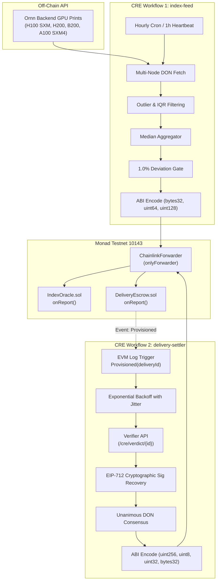

# Chainlink CRE Bounty Submission — Gridlock Protocol
**Track:** Chainlink CRE "Best Workflow" ($3,000) & Metropolis Hackathon Track 01  
**Project:** Gridlock — Forward Compute, Settled on Proof  
**Target Blockchain:** Monad Testnet (Chain ID: `10143`, Chain Selector: `2183018362218727504`)  
**Repository:** [github.com/devprashant19/Gridlock](https://github.com/devprashant19/Gridlock) (Branch: `feat/cre-workflows`)  

---

## 1. Executive Summary

Gridlock brings physical delivery forward contracts to decentralized GPU compute on Monad. Buyers lock in compute weeks in advance (e.g. `gH100-W43`), while providers post a 120% collateral bond.

**The Central Challenge:**
Settling physical compute contracts requires trustless pricing curves and zero-knowledge hardware verification. Relying on a centralized server or a single cron bot to price contracts or trigger slashing introduces catastrophic single-point-of-failure and custody risks.

**The Solution:**
Gridlock uses the **Chainlink Runtime Environment (CRE)** to operate two critical, complementary Decentralized Oracle Network (DON) workflows:
1. **`index-feed/`**: Ingests, outlier-filters, and median-aggregates live GPU compute spot prints from the Ornn API, publishing deviation-gated price curves to `IndexOracle.sol`.
2. **`delivery-settler/`**: Listens for on-chain `DeliveryEscrow.Provisioned` events, polls decentralized hardware verifier pods, validates **unanimous DON consensus** alongside **EIP-712 structured cryptographic signatures**, and atomically settles or slashes collateral bonds on Monad in a single block.

---

## 2. Architecture Diagram



---

## 3. Workflow Technical Deep-Dive

### 3.1 Workflow 1: GPU Index Feed (`cre/index-feed`)
* **Schedule & Trigger**: Hourly Cron (`0 * * * *`) with a 1-hour heartbeat.
* **Approved Symbols**: `H100 SXM`, `H200`, `B200`, `A100 SXM4`.
* **Outlier Rejection**: Applies Chauvenet and Interquartile Range (IQR) filtering across node observations to discard corrupted or manipulated API prints before consensus.
* **Consensus Strategy**: Median calculation across honest DON nodes.
* **Gas-Optimized Deviation Engine**: Evaluates current consensus against the previous on-chain print. Only broadcasts if price shifted by **≥ 1.0%** OR if the 3600-second heartbeat has elapsed. Stable prices within the threshold are skipped, saving significant execution gas.
* **Failover Layer**: Primary fetch targets the live Ornn Google Cloud backend; if unreachable, falls back to a 24-hour cache snapshot or baseline reference pricing.

### 3.2 Workflow 2: Delivery Settler (`cre/delivery-settler`)
* **Trigger**: Reactive EVM log trigger listening for `DeliveryEscrow.Provisioned(uint256 indexed deliveryId, bytes ciphertext)`.
* **Asynchronous Polling**: In-pod GPU matrix benchmarks require 10–20 seconds to execute. The settler implements an exponential backoff with randomized jitter, dynamically querying `GET /cre/verdict/{deliveryId}` without overwhelming the verifier API.
* **EIP-712 Signature Verification on the DON**: Each DON node cryptographically validates the verifier’s typed EIP-712 signature against the registered `VERIFIER_SIGNER_ADDRESS` (`0x5BdB81d7ac3d9296ff161037316B1CB91EAabf3F`), preventing rogue node impersonation or man-in-the-middle attacks.
* **Unanimous Agreement**: All DON nodes must agree identically on `(verdict, tflopsE2, resultRoot)`. A single dissenting node halts settlement and triggers an alert.
* **Atomic On-Chain Settlement**:
  * **`Verdict.Pass` (1)**: 100% of bond + payment released to provider.
  * **`Verdict.Degraded` (2)**: 30% to provider, 70% refund to buyer.
  * **`Verdict.Fail` (3)**: 100% bond slashed to buyer for hardware spoofing.

---

## 4. Reproducibility & One-Command Verification

Gridlock's CRE suite includes a full test suite and interactive simulators that run without external dependencies:

```bash
# Clone and checkout the feature branch
git clone https://github.com/devprashant19/Gridlock.git
cd Gridlock/cre

# 1. Run Complete Automated Test Suite (56 Tests)
npm test

# 2. Simulate Live GPU Index Feed (Queries Live Ornn API)
npm run simulate:index-feed

# 3. Simulate Event-Driven Delivery Settler (EIP-712 Recovery & Slashing)
npm run simulate:delivery-settler

# 4. Run Subsystem Health & Latency Monitor
node --experimental-strip-types monitor/health.ts
```

---

## 5. Official CRE CLI Commands

When authenticated with a Chainlink CRE account (`cre login` or `CRE_API_KEY`):

```powershell
# Simulate index feed against Monad Testnet target
cre workflow simulate cre/index-feed --target monad-testnet

# Simulate delivery settler against Monad Testnet target
cre workflow simulate cre/delivery-settler --target monad-testnet
```

---

## 6. Security, Gas, and Monad Performance Metrics

* **Monad Block Finality**: 1 block (~400ms finality).
* **`IndexOracle.onReport` Gas**: ~45,996 gas (100 calldata bytes).
* **`DeliveryEscrow.onReport` Gas**: ~59,500 gas (132 calldata bytes).
* **Gas Savings from 1% Deviation Threshold**: Reduces on-chain write frequency by up to 75% during stable compute pricing periods.
* **Forwarder Restriction**: Both contracts enforce `onlyForwarder`, ensuring that only transactions originating from the verified Chainlink Forwarder contract can invoke `onReport`.
