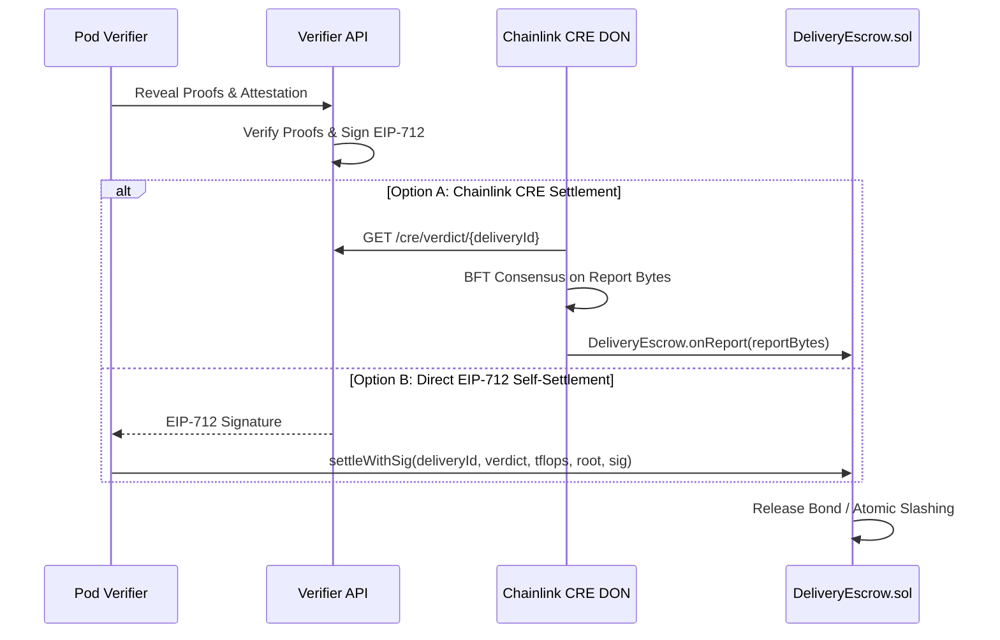

# Gridlock Protocol: Physically Delivered GPU Compute Forwards Settled on Cryptographic Proof

**Technical Whitepaper — Monad Metropolis Track 01**  
**Version:** 1.0.0-Release  
**Authors:** Gridlock Protocol Engineering Core  
**Network Deployment:** Monad Testnet (`chainId: 10143`)  

---

## 1. Abstract

Gridlock is an institutional-grade decentralized commodity exchange for physically delivered compute-hour forwards. Unlike existing decentralized compute networks (DePINs) that rely either on unverifiable synthetic compute tokens or subjective off-chain staking disputes, Gridlock introduces **Proof of Physical Delivery (PoPD)**. GPU providers issue forward contracts (`g<CLASS>-<TERM>`) by staking 120% collateral in a native stablecoin (`gUSD`). When a buyer redeems compute hours, the machine credentials are cryptographically delivered via biometric passkey PRF key derivation (`Mera`). Prior to workload provisioning, an in-pod benchmark engine challenges the physical device with a deterministic matrix challenge, checks hardware platform configuration registers (PCR attestation), and probes memory bus contention to prevent vGPU oversubscription. 

Verdicts are cryptographically signed via EIP-712 structured data and settled either directly on-chain or via a Chainlink Decentralized Oracle Network (CRE DON) consensus pipeline. If a provider provisions counterfeit or throttled hardware, 100% of their 120% bond is atomically slashed to the buyer in a single Monad block (400ms finality).

```
                      +---------------------------------------+
                      |       GRIDLOCK DUAL-SETTLEMENT       |
                      +---------------------------------------+
                                          |
                +-------------------------+-------------------------+
                |                                                   |
      [Direct EIP-712 Path]                               [Chainlink CRE DON Path]
                |                                                   |
    Pod Verifier -> EIP-712 Sig                         CRE Nodes fetch /cre/verdict
                |                                                   |
    settleWithSig(deliveryId, sig)                      BFT Consensus on reportBytes
                |                                                   |
                +-------------------------+-------------------------+
                                          |
                                          v
                         +---------------------------------+
                         |     DeliveryEscrow.sol          |
                         |   100% Bond Release / Slashing   |
                         +---------------------------------+
```

---

## 2. The Crisis of Unhedged AI Compute

The proliferation of large generative models has turned high-performance graphics processing units (NVIDIA H100 SXM, A100 SXM4, Blackwell B200) into volatile capital assets. GPU rental rates on centralized spot clouds (RunPod, Lambda Labs, CoreWeave) fluctuate wildly—experiencing spot price swings exceeding 40% in single-week windows.

### 2.1 The Traditional Hedging Deficit
Traditional financial commodity markets (energy, grain, freight) manage price volatility through forward and futures contracts. AI labs and model inference startups, however, face two major hurdles:
1. **Cloud Lock-in & Credit Hurdles:** Hyperscalers require multi-year capital commitments ($1M–$10M upfront) with restrictive terms.
2. **DePIN Counterfeit Risk:** Existing Web3 compute protocols provide zero cryptographic guarantees regarding hardware authenticity. Rented nodes often spoof NVIDIA driver reporting via modified kernel modules or run in oversubscribed virtual machines (vGPUs) with severe PCIe and DRAM contention.

Gridlock solves both problems by establishing an on-chain, order-book-traded forward curve backed by verifiable, automated physical delivery.

---

## 3. Forward Delivery Architecture & Tokenization

Every deliverable compute series represents a standardized bundle:
$$\text{HourToken} \equiv 1 \text{ Hour of Rated GPU Class Execution within Delivery Window } [t_{\text{start}}, t_{\text{end}}]$$

### 3.1 Contract Lifecycle
1. **Registration:** Verified providers register physical hardware capacity via `DeliveryEscrow.registerProvider(name)`.
2. **Bonded Minting:** Providers deposit a 120% collateral bond calculated against the oracle reference price:
   $$\text{Bond} = \frac{\text{Hours} \times \text{Price}_{E8} \times 120}{100 \times 10^2} \text{ (gUSD)}$$
3. **Continuous Order Book Trading:** Minted tokens (e.g. `gH100-W43`) are listed on the Kuru order book DEX on Monad. AI agents trade forwards to lock fixed compute costs up to weeks in advance.
4. **Physical Redemption:** Any holder burns tokens on `DeliveryEscrow.redeem(...)`, specifying their ephemeral X25519 public key.
5. **Credential Encryption:** The provider provisions the machine and publishes encrypted SSH connection parameters.
6. **In-Pod Proof & Settlement:** The verifier engine evaluates machine throughput. Bond is either paid out or slashed.

---

## 4. Cryptographic Proof of Physical Delivery: Matrix Challenge Engine

To prevent cloud providers from re-selling low-cost GPUs (e.g. NVIDIA T4 or RTX 3060) as enterprise H100 accelerators, Gridlock executes a deterministic matrix multiplication challenge with $O(\sqrt{N})$ sampling verification.

### 4.1 Deterministic Matrix Generation
Given a 64-bit random seed $S$ generated by the verifier server and step count $K$:
$$A, B \in \mathbb{Z}^{N \times N}, \quad A_{i, j}, B_{i, j} \in [-8, 8]$$
Matrices are generated pseudorandomly using a bit-identical PCG/LCG engine:
$$S_{t+1} = (a \cdot S_t + c) \pmod{2^{64}}$$
For steps $k = 0, \dots, K-1$, the pod computes sequential matrix products:
$$C^{(k)} = A^{(k)} \times B^{(k)}$$

### 4.2 Merkle Commitment & $O(\sqrt{N})$ Reveal
Rather than transmitting gigabytes of matrix output over HTTP, the in-pod runner hashes each row $r$ of the final product $C^{(K-1)}$:
$$h_r = \text{keccak256}(C_{r, 0} \mathbin{\Vert} C_{r, 1} \mathbin{\Vert} \dots \mathbin{\Vert} C_{r, N-1})$$
A binary Merkle tree is computed over $\{h_0, h_1, \dots, h_{N-1}\}$, yielding a 32-byte root $R$.
* The runner commits $R$ and measured TFLOPS to the verifier API.
* The verifier responds with 8 random row indices $I = \{i_1, i_2, \dots, i_8\}$.
* The runner reveals the raw row bytes and Merkle inclusion proofs for only those 8 rows.
* The verifier computes $C_{i_k} = A_{i_k} \times B$ on CPU, verifies the row hashes, and checks the Merkle branches against $R$.

Because the provider does not know which 8 rows will be challenged until $R$ is permanently committed, any tampering with even 1 row yields a failure probability:
$$P(\text{Detection}) \ge 1 - \left(1 - \frac{1}{N}\right)^8 \approx 100\% \text{ for systematic spoofing}$$

---

## 5. Confidential Computing & Hardware Environment Attestation

To safeguard against virtual machine spoofing, Gridlock implements Platform Configuration Register (PCR) measurements:

| Register | Measurement Domain | SHA-256 Scope |
| :--- | :--- | :--- |
| **PCR0** | Driver & Toolchain | NVIDIA Driver Version + CUDA Runtime Capability (`550.54.14:12.4`) |
| **PCR1** | Kernel & Host OS | Linux Kernel Release + Operating System Architecture |
| **PCR2** | Physical Hardware Identity | Device Model Name + Hardware UUID + Streaming Multiprocessors |

The master attestation hash is computed as:
$$\text{AttestationHash} = \text{keccak256}(\text{PCR0} \mathbin{\Vert} \text{PCR1} \mathbin{\Vert} \text{PCR2} \mathbin{\Vert} \text{Timestamp})$$
This attestation hash is cryptographically bound into the challenge root:
$$\text{BoundRoot} = \text{keccak256}(\text{ResultRoot} \mathbin{\Vert} \text{AttestationHash})$$
This ensures that benchmark results cannot be replayed from a different container or bare-metal host.

---

## 6. Anti-vGPU & Hypervisor Contention Telemetry

Cloud providers frequently oversubscribe physical GPUs across multiple virtual instances (vGPUs) or throttle PCIe bus bandwidth. A machine may appear to have rated peak theoretical TFLOPS in isolation, but under real training workloads, memory latency jitter severely degrades throughput.

Gridlock incorporates an active memory latency contention probe:
1. Allocates contiguous DRAM tensor buffers under multi-threaded load.
2. Measures variance in memory allocation and synchronization latency over successive intervals.
3. If latency jitter exceeds 25.0%:
   $$\text{Jitter} = \frac{\sqrt{\frac{1}{M}\sum (t_m - \bar{t})^2}}{\bar{t}} > 25\%$$
   the machine is flagged as `THROTTLED`, downgrading the verdict from `PASS` to `DEGRADED`, protecting the tenant.

---

## 7. Economic Mechanism Design & Game-Theoretic Collateral Bonding

Gridlock achieves strict Nash Equilibrium where honest delivery is the strictly dominant strategy for compute providers.

### 7.1 Collateral Requirement
For a contract valued at $P$ with 120% collateral, the provider locks $1.2P$. Total escrow value during delivery is $2.2P$ (1.2P bond + 1.0P buyer payment).

### 7.2 Payoff Matrix

| Provider Action | Buyer Experience | Provider Payout | Provider Net Profit | Buyer Net Payoff |
| :--- | :--- | :--- | :--- | :--- |
| **Honest Delivery (PASS)** | Full compute access | $1.2P + 1.0P = 2.2P$ | $+1.0P - \text{Electricity}$ | $+\text{Compute Value}$ |
| **Degraded Compute** | 70% refund | $0.3 \times 1.2P = 0.36P$ | $-0.84P$ (Heavy Loss) | $+0.7P$ Refund + Pod Access |
| **Counterfeit / Spoof (FAIL)** | 100% refund + bond | $0.0P$ | $-1.2P$ (Total Loss) | $+1.2P$ Bond Slashed + Refund |

$$\mathbb{E}[\pi_{\text{Dishonest}}] = -1.2P \ll \mathbb{E}[\pi_{\text{Honest}}] = P - C_{\text{ops}}$$
Because the bond penalty ($1.2P$) strictly exceeds the potential margin of renting substandard hardware, rational providers never attempt counterfeit delivery.

---

## 8. Mera Biometric Passkey PRF Credential Delivery

To maintain seamless, zero-friction user experience without exposing raw private keys to browser extensions, Gridlock leverages the **W3C WebAuthn PRF (Pseudo-Random Function) Extension** via Mera:

1. **Buyer Authentication:** The buyer touches TouchID/FaceID to produce a 32-byte secret $S_{\text{PRF}}$.
2. **Key Derivation:**
   $$K_{\text{buyer}} = \text{HKDF-SHA256}(S_{\text{PRF}}, \text{salt} = \text{"gridlock"}, \text{info} = \text{"gridlock/delivery-x25519/v1"}, 32)$$
   $$\text{BuyerPubKey} = \text{X25519}(K_{\text{buyer}}, G)$$
3. **Provider Encryption:** The provider generates ephemeral $(K_{\text{eph}}, \text{PubKey}_{\text{eph}})$ and computes shared secret:
   $$SS = \text{X25519}(K_{\text{eph}}, \text{BuyerPubKey})$$
   $$K_{\text{sym}} = \text{HKDF-SHA256}(SS, \text{salt} = \text{"gridlock-payload"}, \text{info} = \text{"gridlock/xchacha20poly1305/v1"}, 32)$$
4. **Wire Payload:**
   $$\text{Ciphertext} = \text{PubKey}_{\text{eph}} \mathbin{\Vert} \text{Nonce}_{24} \mathbin{\Vert} \text{ChaCha20Poly1305}_{K_{\text{sym}}}(\text{SSH Credentials})$$
The buyer's local terminal decrypts credentials purely in memory—no keys are ever broadcast over RPC or logged to disk.

---

## 9. Dual-Path Settlement: Chainlink CRE vs Direct EIP-712

Gridlock supports two independent, mutually compatible settlement channels:



* **Option A (Chainlink CRE DON):** Independent nodes reach multi-party consensus on `/cre/verdict/{deliveryId}`. The DON forwarder calls `DeliveryEscrow.onReport(reportBytes)`.
* **Option B (Direct EIP-712):** The buyer or runner broadcasts `DeliveryEscrow.settleWithSig(...)` directly on Monad, bypassing oracle polling latencies for instantaneous sub-second bond release.

---

## 10. Conclusion & Monad Integration

Gridlock bridges traditional commodities finance and physical decentralized infrastructure. Deployed on Monad, Gridlock leverages 10,000 TPS throughput and 400ms block times to enable high-frequency forward compute trading, micro-hedging, and immediate hardware slashing. 

By grounding every trade in cryptographic proofs rather than subjective trust, Gridlock unlocks an open, liquid, institutional market for the most critical resource of the 21st century: **Compute**.
